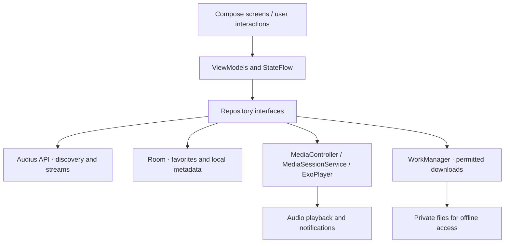

# Hipka Music


A Kotlin / Jetpack Compose music app with a wine-and-navy visual identity, English and Persian interfaces, and music discovery powered by **Audius**.

Originally a university team project, now being maintained as a personal portfolio project. Original contributions by **Parand Khalili, Hasti Kabirsamadi, and Kiana** remain in Git history.

## Music without hosting a catalog

The default app browses trending tracks, searches, and streams music from the [Audius public API](https://docs.audius.co/api/). No Supabase music uploads, paid subscription, or API secret is needed. Most read endpoints support unauthenticated access; quotas, availability, and catalog contents are controlled by Audius. This is an independent-artist catalog, not a promise of every commercial release.

Only public, streamable, ungated tracks are listed. Download requests recheck the provider's download permission and use its download endpoint. Streaming permission does not imply permission to download or redistribute music. Artist names and artwork are retained.

## Implemented functionality

- Trending discovery, search, artist browsing, and complete playback queues.
- Media3 background playback and media notifications; audio focus and headphone-disconnect handling.
- Shuffle, repeat, seek, playback speed, and sleep timer.
- Local favorites, recent listening, search history, and cached catalog metadata through Room.
- WorkManager downloads for provider-permitted tracks; private storage and offline playback.
- Material 3 light/dark themes, English/Persian localization, and RTL layouts.
- A local library that works without signing in.

Supabase social/profile/chat and editorial playlist code from the university project remains for legacy demonstration. It is **not a production authentication system** and is disabled by default. Favorites are local; they do not modify an Audius account. Offline catalog metadata does not guarantee that audio is downloaded.

## Build

Requirements: JDK 17 or newer (tested setup uses Android Studio's bundled JDK), Android SDK Platform 35 and Build Tools, and network access for Gradle dependencies. Minimum device version: Android 7 / API 24.

```sh
git clone https://github.com/Parand1khalili/Hipka_Music.git
cd Hipka_Music
./gradlew :app:assembleDebug :app:testDebugUnitTest :app:lintDebug
```

On Windows use `gradlew.bat`. Open the project in Android Studio to configure the SDK, or set `ANDROID_HOME`. The default Audius app requires no `local.properties` credentials. Debug APK: `app/build/outputs/apk/debug/app-debug.apk`.

Official Google/Maven repositories are the defaults. On restricted networks, `HIPKA_MAVEN_MIRROR` can specify an explicitly trusted HTTPS Maven mirror. Do not commit machine-specific repository or SDK paths.

## Optional legacy Supabase demonstration

See [the configuration example](local.properties.example). Use an isolated test project and disposable credentials only. Set `hipka.legacyDemoAuth=true` to opt into the old **debug-only** sign-in implementation. Release builds always disable it. The original table schema and RPCs are not provisioned by this repository.

The old implementation compares passwords via PostgREST queries and treats a stored user ID as a session. It cannot be made production-safe solely by modifying this client. Production deployment requires migration to Supabase Auth, authenticated JWTs, reviewed Row Level Security, and server-controlled premium entitlements. No production database changes are performed by this project. Never put service-role or secret keys in an APK. See [security notes](docs/SECURITY.md).

## Architecture

```text
Compose screens → ViewModels / StateFlow → repository interfaces
                                          ├─ Audius API (catalog)
                                          ├─ Room (library/cache)
                                          ├─ MediaController → MediaSessionService / ExoPlayer
                                          └─ WorkManager → download worker / private files
```

### Data and playback flow



*This architecture describes the repository's implementation paths, not an animation or simulated screenshot. See [verification notes](docs/VERIFICATION.md) for tested behaviors and outstanding manual checks.*

Hilt wires dependencies. Retrofit/OkHttp and Kotlin serialization handle HTTP; the Audius client is separate from the legacy Supabase client so backend credentials are never attached to music-provider requests. Settings and optional legacy session IDs use DataStore.

Source folders: `presentation` (screens/navigation/state), `domain` (models/contracts), `data` (repositories/API/Room/player/downloads), `di` (dependency wiring), and `service` (background playback).

## Validation and limitations

See [verification notes](docs/VERIFICATION.md) for executed checks and remaining manual scenarios. Unit tests cover provider response parsing, gated-track filtering, stable stream URLs, malformed IDs, and coroutine cancellation. GitHub Actions builds, tests, and lints each push.

There are no fabricated screenshots or test badges. Device screenshots should be added only after capturing a running, verified build. Existing legacy backend features, process-death playback restoration, provider quotas, and real-device audio routing need further validation. No license grant is inferred for third-party music or original team assets.
